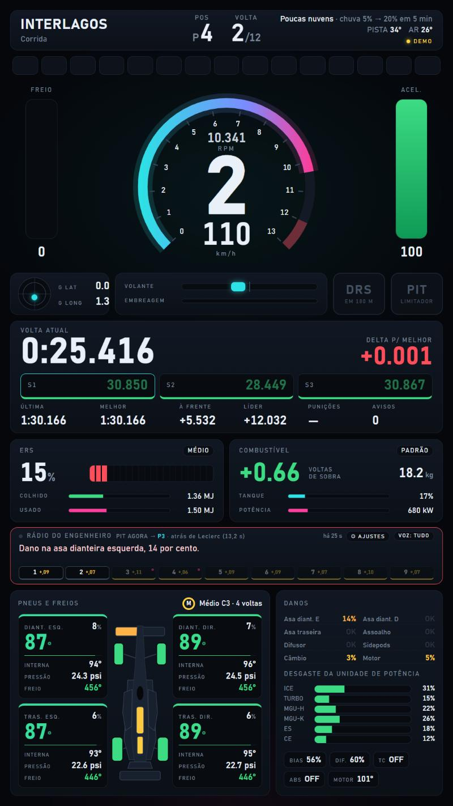
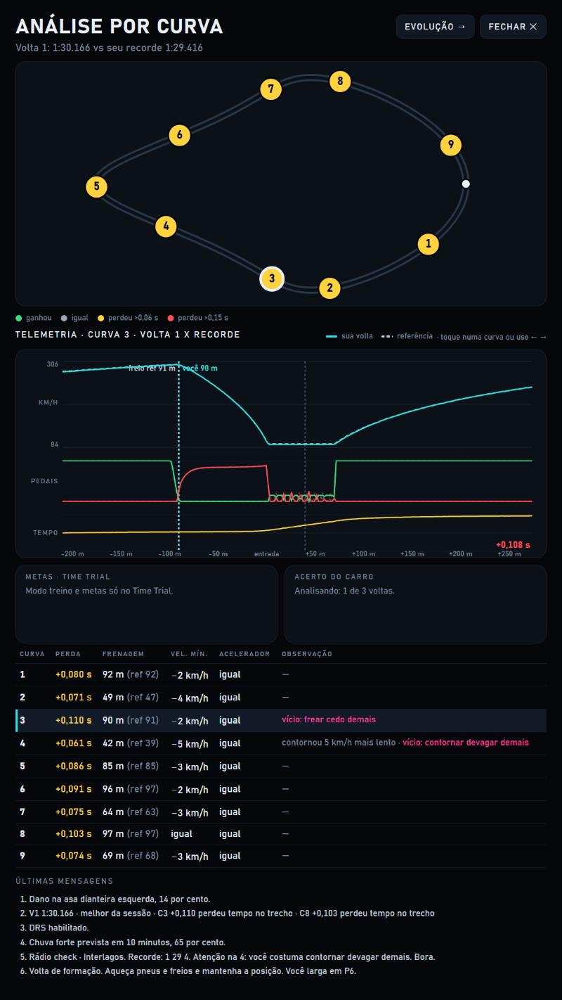
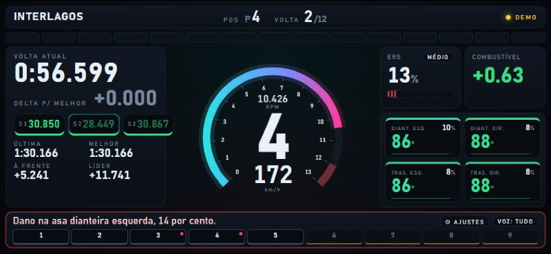

# Painel F1 25: telemetry dashboard and race engineer with voice

[Português](README.md) · **English**

A car-cluster style dashboard for **F1 25**, built for a vertical second monitor, a tablet or your phone. It comes with a **race engineer who talks to you over the radio, in English or Portuguese**:

- analyses every corner, learns your habits and tracks your progress;
- runs your pit strategy;
- answers your steering wheel buttons, your controller, hotkeys and your voice, even with the game in the foreground.

<p align="center">
  
  
  
</p>

> Fan project, not affiliated with EA, Codemasters or Formula 1. It only uses the official UDP telemetry the game sends: it doesn't touch the game and doesn't use mods. The screenshots above show the Portuguese interface.

## What it does

- **Dashboard:**
  - RPM and shift lights, gear, speed, pedals, steering and G-force;
  - DRS or active aero;
  - lap times, sectors and delta to your best lap;
  - ERS and fuel;
  - tyre temperature, pressure and wear, brakes, damage and power unit.
- **A real program:** a single `.exe`, no installer. It opens straight into the dashboard, and everything lives in the **☰** menu.
- **Commands without leaving the game:** global hotkeys (Ctrl+Alt+…) and an Xbox controller work with F1 25 in the foreground.
- **Overlay:** a transparent strip on top of the game with position, delta, rivals, ERS, fuel, the engineer's radio and each corner's minisector.
- **Engineer with a natural voice:** only talks on the straights, calls you by name, has a team radio sound and changes tone with the situation.
- **Corner-by-corner analysis:**
  - tells you where you lost time and why, for example *"In turn 3 you braked at 131 metres, the record brakes at 90"*;
  - reminds you before that corner on the next lap;
  - has a telemetry chart comparing your lap with your record.
- **Memory:** record and ideal lap per track, habits that keep repeating, a summary of each session and the **Progress** page with charts.
- **Race:** replaces the in-game engineer. Uses the drivers' names and calls box box, the pit limiter, rival stops, undercut and overcut, safety car, penalties, weather and the drop zone in qualifying.
- **Pit strategist:** learns what a stop costs at each track and predicts where you'll rejoin.
- **Timing tower:** the whole grid with gaps, intervals, tyre compound and age, stops, last and best lap.
- **Ask by voice:** press a button and talk (*"how are my tyres?"*, *"how am I doing in turn 3?"*): he answers on the radio. In the program, your voice is understood on your own PC, with no internet.
- **Time Trial:** single-corner practice mode, daily goals and achievements.
- **Setup:** detects understeer and oversteer, suggests one change at a time within the game's limits and, once you change it, tells you whether it helped.
- **Layouts:** portrait monitor, landscape monitor or tablet, and phone (compact, large text).
- **Two languages:** English and Portuguese, for the dashboard, the program and the engineer's voice.

## Installation (Windows)

Nothing to install: it's a single file.

1. On the **[Releases](https://github.com/matheeusper/f1-dashboard/releases/latest)** page, download **`PainelF1.exe`** and put it in a folder of your own, for example `Documents\PainelF1`.
2. **Set up the game** (only once). In F1 25, go to **Settings → Telemetry**:

   | Option | Value |
   |---|---|
   | UDP Telemetry | On |
   | UDP Broadcast Mode | Off |
   | UDP IP Address | 127.0.0.1 |
   | UDP Port | 20777 |
   | UDP Send Rate | 60 Hz |
   | UDP Format | 2025 or 2026 (both work) |

3. Double-click **`PainelF1.exe`**. The dashboard opens full screen on the vertical monitor, or in a window if you don't have one.
4. Start the game and go out on track: the dashboard lights up by itself.

The first time, Windows may show *"Windows protected your PC"*, because the program isn't digitally signed. Click **More info → Run anyway**.

Your data lives in the `dados` folder, created next to the `.exe`. To update, just replace `PainelF1.exe` and keep that folder. Coming from version 1.x, put the new `.exe` in the same folder and your history carries on.

### The ☰ menu

Click the **☰** in the corner of the dashboard, press **Esc**, or use **Ctrl+Alt+Space** from inside the game.

| Item | What it does |
|---|---|
| **Telemetry source:** Game · Demo race · Demo Time Trial | Changes where the data comes from. The demos show everything working without the game and save to a separate history |
| **📱 Phone and tablet on the network** | Shares the dashboard on your local network and shows the address to type on the device |
| **🖥 Overlay on top of the game** | Turns the strip on top of the game on and off |
| **Screens** | Timing tower, Lap analysis, Progress, Radio and voice, **Controls and keys** |
| **Program** | Language, full screen or window, and quit |

The program also sits in the Windows tray, next to the clock, with: show dashboard, overlay and quit. Closing the dashboard window quits the program.

**Overlay:** works with F1 25 in **borderless full screen**. In exclusive full screen, Windows doesn't let any window stay on top.

## Commands with the game in focus

**Keyboard** (you can change them in ☰ → Controls and keys → record):

| Key | What it does |
|---|---|
| Ctrl+Alt+Space | Opens the ☰ menu |
| Ctrl+Alt+M | Talk to the engineer |
| Ctrl+Alt+1 … 0 | The questions of the UDP Action 1 to 10 buttons |
| Ctrl+Alt+P | Timing tower |
| Ctrl+Alt+A | Lap analysis |
| Ctrl+Alt+O | Overlay on and off |
| Ctrl+Alt+X | Closes the tower, analysis and settings |

**Controller** (XInput: Xbox, or PlayStation through Steam Input/DS4Windows). **Hold View/Back** and press:

| Button | What it does |
|---|---|
| A | Talk to the engineer |
| X | Tyres |
| B | Gaps |
| Y | Pit strategy |
| ↑ / ↓ / ← / → | Fuel / Where am I losing time / Weather / Repeat |
| LB / RB | Tower / Analysis |
| Start | ☰ menu |
| RS (right stick click) | Closes the screens |

Holding View/Back is there so nothing fires by accident while you drive. To change a button: ☰ → Controls and keys → record, and press the new button on the controller.

**Steering wheel:** F1 25's **UDP Action** buttons work too (see [Steering wheel buttons](#steering-wheel-buttons)).

## Race engineer

The engineer talks to you and shows the messages in the **ENGINEER RADIO** strip. He only talks on the straights, never under braking or mid-corner. Urgent warnings, like damage, penalties or the safety car, wait 2 seconds at most.

**Voice and personality:** press **C**, or open ☰ → Radio and voice, to choose:
- **Language:** English or Português. The whole dashboard and the engineer switch together.
- **Your name on the radio:** he calls you by your first name (*"Yes, Max! New personal best!"*). By default he uses the name of the driver you picked in the game, including a custom driver in Career or My Team. Online, or with that option turned off, he uses the name you typed.
- **The voice:** in English, Ryan or Sonia (British), Andrew (American) or William (Australian), all Microsoft neural voices that sound human. In Portuguese, Antonio, Francisca or Thalita. Or the Windows voice, which works offline.
- **Speed and volume.** The **▶ TEST VOICE** button does a radio check.
- **Team radio sound:** beeps when the transmission opens and closes, a filtered voice and adjustable static.

He changes tone with the situation (excited on a record, quick on an urgent warning, calm with tips) and varies his phrases so he doesn't sound like a recording. The natural voices need the internet. Offline, the dashboard switches to the Windows voice by itself.

### Corner by corner

On the first clean lap, the engineer maps the track's corners and numbers them in order: Turn 1, 2, 3… On every lap after that, he compares each corner with your reference and tells you where you lost time and why:
- braked too early;
- braked late and overshot;
- slower through the corner;
- got on the power late;
- locked a wheel;
- wheelspin on exit.

On the next lap, he warns you **before** the corner: *"Turn 3, brake at 90 metres."*

- **Brake points in metres:** measured like the 100/50 m boards, from the point where the steering starts to turn on your reference lap.
- **Live minisectors:** as you leave each corner, the dashboard flashes the gain or loss in that section (**TURN 4 +0.061**).
- **Telemetry comparison (key A):**
  - track map coloured by corner;
  - speed, throttle and brake of your lap over the reference;
  - the brake points;
  - time gained or lost through the corner.

### Memory and progress

Everything is saved in `dados/historico.sqlite3`:
- **Record per track:** the telemetry of your best lap becomes the reference for the next sessions.
- **Ideal lap:** the sum of your best sections.
- **Quali pace vs race:** record, ideal lap, weak spot and the comparison with the previous session are split into two groups: **quali pace** (Time Trial and qualifying, low fuel and new tyres) and **race** (race and free practice). That way your Time Trial record never becomes an impossible target on a full tank.
- **Habits:** mistakes that keep repeating in the same corner, counted across every session type. He brings them up at the start of the session and before the corner.
- **Session summary:** compares with the previous session of the same group and tells you where you improved and what to work on.
- **Progress page** (☰ → Progress, key **E**, or `http://127.0.0.1:8025/evolucao`): chart per session, corner-by-corner table with trends and habits, and achievements. At the top you pick quali pace, race or everything.

### Race and qualifying (instead of the in-game engineer)

- **Start and position:** formation lap, lights out, *"You got Leclerc! P4"*, *"You're leading!"*
- **Your stop:**
  - *"Box, box"* on the strategy lap, with a prediction of where you'll rejoin;
  - **"Limiter! Limiter!"**;
  - stop time and cold tyres.
- **Strategist:**
  - learns what a stop costs at each track;
  - predicts your position if you stop now (**PIT NOW → P7** on the radio);
  - calls *"Safety car deployed! A stop only costs about 12 seconds now"*;
  - warns about the undercut and overcut;
  - compares your tyres with your rivals'.
- **Rivals:** *"Norris has pitted, onto hards"*, pace (*"you'll catch them in 4 laps"*), DRS behind, retirements, other drivers' fastest laps.
- **Rules and car:**
  - fuel, with lift and coast at the right corners;
  - hot or cold tyres and brakes;
  - tyre wear;
  - pit window, rain and the two-compound rule;
  - track limits, penalties, damage, punctures, safety car and flags.
- **Qualifying:** time remaining, the **drop zone** (*"P17, in the drop zone. The cut-off is Lindqvist, 2 tenths needed"*), *"car on a flying lap behind"* and traffic ahead.

**To turn off the in-game engineer:** lower the race engineer volume in F1 25's **Audio** settings. The MFD on your wheel keeps working as normal.

### Steering wheel buttons

F1 25 has **"UDP Action 1" to "UDP Action 12"** buttons. Map them in **Settings → Controls** (usually at the end of the list) and the engineer answers right away:

| Button | You ask | He answers, for example |
|---|---|---|
| UDP Action 1 | Tyres | "Mediums with 7 laps on them. Wear at 18 percent, the worst is the front left. At this rate they hit 70 percent in about 12 laps." |
| UDP Action 2 | Gaps | "P4. Norris, P3, is 1.2 seconds ahead, you're taking 2 tenths a lap." |
| UDP Action 3 | Fuel and battery | "Fuel plus 0.4 laps, standard mix. Battery at 64 percent." |
| UDP Action 4 | Where am I losing time | "Last lap you lost the most in turn 3, 4 tenths: braked at 131 metres, the record brakes at 90." |
| UDP Action 5 | Weather and pit | "Track at 34 degrees. 65 percent chance of rain in 10 minutes. Pit window between laps 6 and 8." |
| UDP Action 6 | Repeat | Repeats the last message. |
| UDP Action 7 | Quiet | Toggles "essentials only" mode. |
| UDP Action 8 | Pit strategy | "A stop here costs about 21 seconds. If you stop now, you rejoin P5, behind Norris." |
| UDP Action 9 | Goals and practice | Progress on each Time Trial goal. |
| UDP Action 10 | Car setup | "Mid-corner understeer in turns 2, 5 and 9. Suggestion: front wing from 28 to 29 (more wing)…" |
| UDP Action 11 | Talk to the engineer | He listens to your question. |

On the dashboard, keys **1 to 9** and **0** (which counts as 10) ask the same questions.

### Talk to the engineer

Press **UDP Action 11** on your wheel, **Ctrl+Alt+M**, **View + A** on the controller, the **M** key or the **🎤** on the dashboard radio. You hear a beep, the radio turns green with *"Listening…"*, and you just talk. He stops listening by himself when you go quiet. For example:

- *"How are my tyres?"*, *"what's the gap ahead?"*, *"how much fuel?"*, *"is it going to rain?"*
- *"Where am I losing time?"*, *"what's the pit strategy?"*, *"how's the setup?"*
- *"How am I doing in turn 3?"*: time lost, why, and where the reference brakes in that corner on the last lap.
- *"Say again"*, *"quiet please"*.

In the program, **Whisper** does the listening, running on your PC: it works offline and with no account. The first time, it downloads the voice model (~150 MB) into `dados\modelos`, and the radio shows the progress. With headphones, it won't hear the engineer himself.

When you open the dashboard in Chrome or Edge (running from source), the browser's speech recognition is used, and it needs the internet. It doesn't work on a phone over the local network, because the browser only allows the microphone on a secure connection.

### Practice mode with goals (Time Trial only)

- **Daily goals:**
  - a lap time to beat;
  - *"5 laps in a row without a lock-up"*;
  - consistency;
  - your habit.

  A completed goal becomes an **achievement** on the Progress page.
- **Practise a corner:** select the corner in the analysis (**A**) and press **T**. Every lap he tells you how far you were from your best section, where you braked against the target and your spread over the last 5 laps.

### Setup analysis

The engineer measures the car's balance on entry, mid-corner and exit of every corner, from the slip angle of the front tyres against the rears. He also looks at wheelspin and tyre temperatures, and only points out what repeats over 3 laps or more.

**Suggestions:** one change at a time, for the problem that shows up in the most corners.
- He only suggests something when most corners agree: if some want one thing and others the opposite, he tells you the balance is mixed and leaves the setup alone.
- He respects the game's limits (brake bias 50–70%, wings 0–50, differential 10–100%, anti-roll bars 1–21): he never suggests going past them.
- In qualifying, sprint and race (parc fermé), he only suggests what the MFD can change: brake bias and on-throttle diff.

| What he sees | What he suggests first |
|---|---|
| Understeer on entry | Brake bias further back (then, off-throttle diff more open) |
| Oversteer on entry | Brake bias further forward (then, off-throttle diff more locked) |
| Mid-corner understeer in fast corners | More front wing (or less rear wing) |
| Mid-corner oversteer in fast corners | More rear wing (or less front wing) |
| Mid-corner understeer in slow corners | Softer front anti-roll bar (or stiffer rear) |
| Mid-corner oversteer in slow corners | Softer rear anti-roll bar (or stiffer front) |
| Oversteer or wheelspin on exit | On-throttle diff more open |

**Before and after:** when you change the setup, in the garage or on the MFD, he drops the old laps, restarts the count and, after 3 laps, compares with the previous setup. He tells you whether it got better, worse or went too far, and which value to go back to. For example: *"Front wing 28→29: mid-corner understeer in fast corners from 4 to 1 corners, lap 0.13 s faster. Better: keep it."* Anything that made it worse isn't suggested again.

## Phone and tablet

1. In the program, turn on **☰ → 📱 Phone and tablet on the network**. It shows the address to type on the device, for example `http://192.168.0.10:8025`.
2. The phone needs to be on the same network as the PC.
3. The first time, allow Painel F1 25 through the Windows firewall: also tick **Public networks** if your network is set as public.

- **Layouts:** the dashboard picks the layout from the screen. On a phone it's compact, with everything large, in landscape or portrait.
- **Full screen:** tap the top bar.
- **Force a layout:** add `?modo=celular` (phone) or `?modo=monitor` to the end of the address.
- **Voice:** set **VOICE: OFF** on the phone so the engineer doesn't talk on two devices.

## Dashboard shortcuts

| Key | What it does |
|---|---|
| **Esc** | Closes the open screen. With nothing open, opens the ☰ menu |
| **A** | Last lap analysis: map, telemetry comparison, goals and setup. Use **← →** or click to change corner |
| **P** | Timing tower: the whole grid (or tap the position) |
| **M** | Talk to the engineer (or the 🎤 on the radio) |
| **E** | Progress page |
| **C** | Radio settings: language, name, voice, speed, volume and radio sound |
| **V** | Voice: all → important only → off |
| **1 to 9, 0** | Questions for the engineer (same as the wheel buttons) |
| **T** | Time Trial: practise the selected corner |

## Common problems

- **"Waiting for F1 25" with the game open:** check the IP 127.0.0.1, port 20777 and that UDP telemetry is on. You need to be on track: in the menus, the game doesn't send data.
- **"UDP port 20777 is already in use":** another telemetry app (SimHub, Crew Chief…) is using the port. Close the other app and click **Try again**.
- **Game on PS5/Xbox or another PC:** turn on **☰ → Phone and tablet on the network** (it then accepts telemetry from the network too) and put this PC's IP in the game (check it with `ipconfig`).
- **The engineer doesn't talk:** check the radio isn't on "VOICE: OFF" (key V).
- **The Ctrl+Alt keys don't work in the game:** another program may be using the same combination. Change it in ☰ → Controls and keys → record.
- **Start the history from scratch:** delete the `dados` folder with the program closed.

**Known limitations:**
- The game doesn't report corner names. The numbering is the engineer's own, in track order, and stays the same between sessions.
- Online, comparing with rivals depends on them having public telemetry.
- Achievements from the Time Trial goals are saved in the language that was active when you earned them.

## For developers

| Folder | What's in it |
|---|---|
| `app/` | The program (Rust + Tauri 2): dashboard window, ☰ menu, overlay, tray, global hotkeys, XInput controller and the Whisper listener. See [app/README.md](app/README.md) |
| `nucleo/` | The Python core: receives the UDP telemetry, runs the engineer and serves the page over HTTP/SSE. The app embeds it |
| `web/` | The dashboard, the Progress page and the overlay (plain HTML, CSS and JS, no build step). `web/i18n.js` translates the pages |
| `tools/` | `checar_traducao.py` (checks the translations) and `gerar_icone.py` (generates the icons) |
| `docs/` | README images |

| Core file | What it does |
|---|---|
| `server.py` | Server: receives the UDP telemetry and sends the state to the page over SSE |
| `f1_packets.py` | Decodes F1 25 packets (2025 and 2026 formats) |
| `engenheiro.py` | The engineer: per-lap analysis, rules, messages, habits, summary |
| `analise.py` | Detects corners and compares laps corner by corner |
| `corrida.py` | Race and qualifying calls (position, pit, rivals, events) |
| `estrategia.py` | Pit strategist |
| `treino.py` | Time Trial practice mode and goals |
| `acerto.py` | Car setup analysis |
| `historico.py` | SQLite history and the Progress page data |
| `voz.py` | Neural voice (edge-tts) and settings |
| `ouvido.py` | Understands the spoken question (keywords) and picks the answer |
| `idioma.py`, `textos_en.py` | Language and the English translation of the engineer and server |
| `simulador.py` | Generates fake telemetry in the game's format, for testing |
| `caminhos.py` | Where files live, running from source or as an executable |

The core only uses the Python standard library, plus [`edge-tts`](https://pypi.org/project/edge-tts/) for the voice. To run from source, install [uv](https://docs.astral.sh/uv/), which downloads the right Python by itself. The code and comments are in Portuguese.

```bash
cd app && cargo run                                   # the program, running the core from source
uv run nucleo/server.py --demo --abrir                # the core only, with the dashboard in Chrome/Edge
uv run nucleo/simulador.py --porta 20777              # the simulator only, sending to a core that's already running
uv run tools/checar_traducao.py                       # checks every text has an English translation
powershell -ExecutionPolicy Bypass -File build-app.ps1  # builds app\target\release\PainelF1.exe
```

**Core options** (`uv run nucleo/server.py [options]`; on Linux and macOS you can use the dashboard this way, in the browser):

| Option | What it does |
|---|---|
| `--abrir` | Opens the dashboard in Chrome or Edge, full screen on the vertical monitor if there is one |
| `--demo` | Simulated telemetry, no game needed |
| `--time-trial` | With `--demo`: simulates a Time Trial |
| `--formato 2026` | With `--demo`: uses the 2026 UDP format |
| `--lan` | Accepts connections from other devices on the network (phone, tablet, console) |
| `--porta-udp N` | Telemetry port (default 20777) |
| `--porta-web N` | Page port (default 8025) |
| `--historico FILE` | Uses a different history file |

**Translations:** texts are written in Portuguese inside `tx("...")` (or `N_("...")` for module-level lists) in Python and `T('...')` in the pages. The English versions live in `nucleo/textos_en.py` and `web/i18n.js`, keyed by the Portuguese text. `tools/checar_traducao.py` lists anything missing.

**Executable:** `build-app.ps1` builds the core with PyInstaller (`build.ps1`, which makes `dist\PainelF1.exe`) and then the Rust app, with that core embedded. The result is a single `.exe`. The same build runs on GitHub Actions (`.github/workflows/executavel.yml`): for every published release, the `.exe` is built on Windows and attached to the release.

The F1 25 UDP specification is on the official EA forums (*Data Output from F1 25*).

## License

[MIT](LICENSE). Use, modify and share freely.
