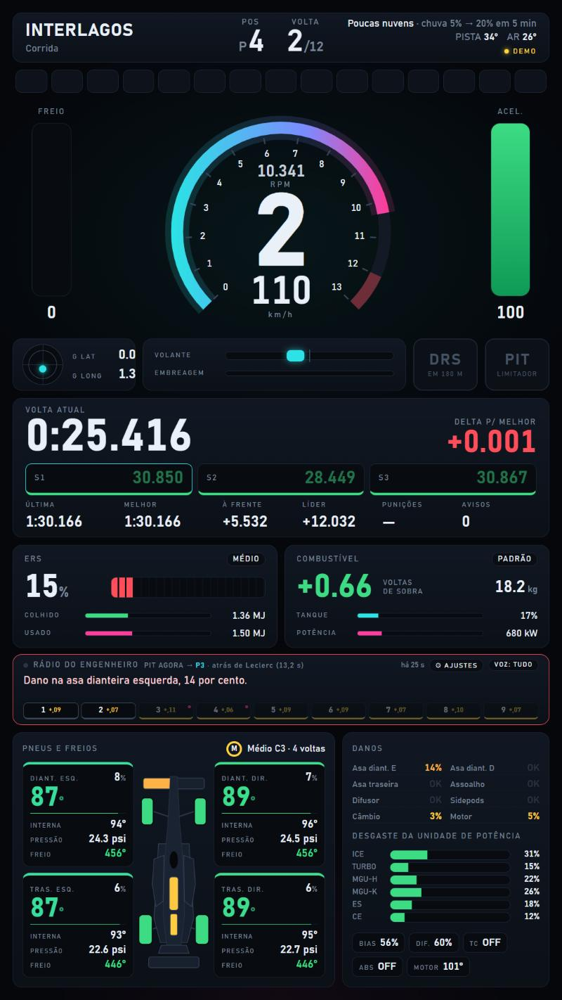
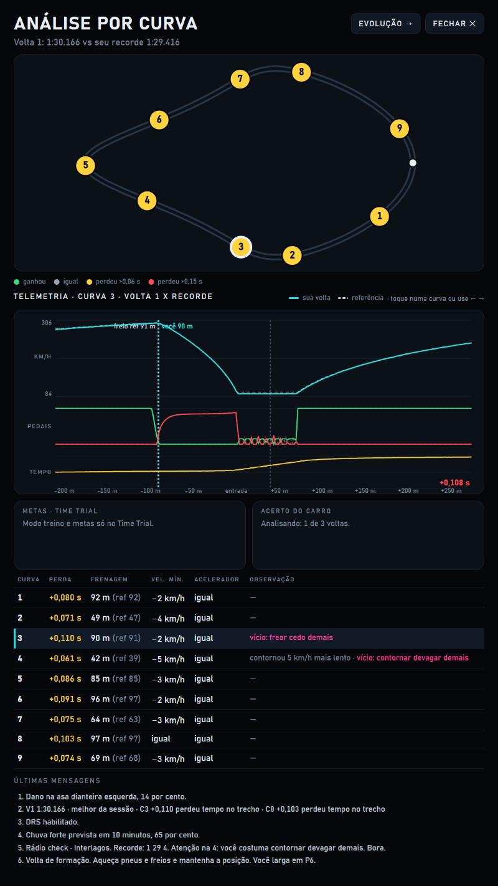
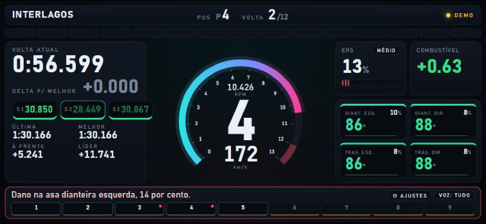

# Painel F1 25: telemetria e engenheiro de corrida com voz

Painel em estilo cluster de carro para o **F1 25**, feito para um segundo monitor na vertical, um tablet ou o celular. Vem com um **engenheiro de corrida que fala com você em português**:

- analisa cada curva, aprende os seus vícios e acompanha a sua evolução;
- faz a estratégia de pit;
- responde pelos botões do volante.

<p align="center">
  
  
  
</p>

> Projeto de fã, sem vínculo com a EA, a Codemasters ou a Formula 1. Usa só a telemetria UDP oficial que o jogo envia: não mexe no jogo e não usa mods.

## O que ele faz

- **Painel:**
  - RPM e LEDs de giro, marcha, velocidade, pedais, volante e força G;
  - DRS ou aero ativa;
  - tempos, setores e delta para a sua melhor volta;
  - ERS e combustível;
  - temperatura, pressão e desgaste dos pneus, freios, danos e unidade de potência.
- **Engenheiro com voz natural:** fala só nas retas, chama você pelo nome, tem som de rádio de equipe e muda o tom conforme a situação.
- **Análise curva a curva:**
  - diz onde você perdeu tempo e por quê, por exemplo *"Na 3 você freou a 131 metros, o recorde freia a 90"*;
  - avisa antes da curva na volta seguinte;
  - tem gráfico de telemetria comparada com o seu recorde.
- **Memória:** recorde e volta ideal por pista, vícios que se repetem, resumo de cada sessão e a página **Evolução** com gráficos.
- **Corrida:** substitui o engenheiro do jogo. Usa os nomes dos pilotos e avisa de box box, limitador, pit dos rivais, undercut e overcut, safety car, punições, clima e zona de eliminação na classificação.
- **Estrategista de pit:** aprende quanto custa um pit em cada pista e prevê onde você volta à pista.
- **Botões do volante:** pergunte sobre pneus, gaps, combustível, estratégia e acerto sem tirar as mãos do volante.
- **Time Trial:** modo treino de uma curva, metas do dia e conquistas.
- **Acerto:** detecta subesterço e sobresterço e sugere ajustes.
- **Layouts:** monitor em pé, monitor ou tablet deitado, e celular (compacto, letras grandes).

## Instalação (Windows)

### Jeito mais fácil: baixar o executável

Não precisa instalar nada: é um arquivo só.

1. Na página de **[Releases](https://github.com/matheeusper/f1-dashboard/releases/latest)**, baixe o **`PainelF1.exe`** e coloque numa pasta sua, por exemplo `Documentos\PainelF1`.
2. **Configure o jogo** (uma vez só): veja a tabela no passo 3 logo abaixo.
3. Dê dois cliques em **`PainelF1.exe`** e escolha no menu:
   - **Iniciar painel**: recebe a telemetria do jogo e abre o painel;
   - **Demo: corrida simulada** e **Demo: Time Trial**: para ver tudo funcionando sem o jogo;
   - **Painel no celular ou tablet**: libera o painel na rede local e mostra o endereço para digitar no aparelho.

Depois de escolher, a janela mostra o status e tem botões para reabrir o painel, abrir a página Evolução ou trocar de modo. **Fechar essa janela desliga o painel.**

Na primeira vez, o Windows pode mostrar *"O Windows protegeu o computador"*, porque o programa não é assinado digitalmente. Clique em **Mais informações → Executar assim mesmo**.

Seus dados ficam na pasta `dados`, criada ao lado do `.exe`. Para atualizar, troque só o `PainelF1.exe` e mantenha essa pasta.

### Rodando pelo código (com uv)

1. **Instale o [uv](https://docs.astral.sh/uv/)**: cole no PowerShell e feche a janela no fim.
   ```powershell
   powershell -ExecutionPolicy ByPass -c "irm https://astral.sh/uv/install.ps1 | iex"
   ```
   Não precisa instalar o Python: o uv baixa a versão certa sozinho.
2. **Baixe o projeto:** botão **Code → Download ZIP** nesta página (e extraia), ou:
   ```powershell
   git clone https://github.com/matheeusper/f1-dashboard.git
   ```
3. **Configure o jogo** (uma vez só). No F1 25, vá em **Configurações → Telemetria**:

   | Opção | Valor |
   |---|---|
   | Telemetria UDP | Ligado |
   | Transmissão UDP | Desligado |
   | Endereço IP | 127.0.0.1 |
   | Porta UDP | 20777 |
   | Taxa de envio | 60 Hz |
   | Formato UDP | 2025 ou 2026 (os dois funcionam) |

4. **Dê dois cliques em `Painel F1 25.bat`.** Ele abre o mesmo menu do executável. Na primeira vez, o uv prepara o ambiente, o que leva cerca de 1 minuto.
5. Escolha **Iniciar painel**: o painel abre sozinho, em tela cheia no monitor vertical. Se não abrir no monitor certo, arraste a janela para ele e aperte **F11**.
6. Abra o jogo e entre na pista: o painel acende sozinho.

**Linux ou macOS:** rode `uv run server.py --menu` (ou `uv run server.py --abrir`) na pasta do projeto.

### Testar sem o jogo

No menu, escolha **Demo: corrida simulada** (rivais, pit stops, safety car e erros de pilotagem) ou **Demo: Time Trial** (modo treino e metas). O demo grava num histórico separado, sem misturar com as suas voltas.

## Engenheiro de corrida

O engenheiro fala com você e mostra as mensagens na faixa **RÁDIO DO ENGENHEIRO**. Ele só fala nas retas, nunca na frenagem ou no meio da curva. Avisos urgentes, como dano, punição ou safety car, esperam no máximo 2 segundos.

**Voz e personalidade:** aperte **C**, ou clique em **⚙ AJUSTES** no rádio, para escolher:
- **Seu nome no rádio:** ele chama você pelo primeiro nome (*"Isso, Max! Recorde pessoal!"*). Por padrão, usa o nome do piloto que você escolheu no jogo, inclusive um piloto personalizado do Modo Carreira ou do My Team. Online, ou com a opção desligada nos Ajustes, vale o nome que você digitou.
- **A voz:** Antonio, Francisca ou Thalita, que são vozes neurais da Microsoft e soam humanas. Ou a voz do Windows, que funciona sem internet.
- **Velocidade e volume.** O botão **▶ TESTAR VOZ** faz um rádio check.
- **Som de rádio de equipe:** bipes ao abrir e fechar a transmissão, voz filtrada e chiado regulável.

Ele muda o tom conforme a situação (animado num recorde, rápido num aviso urgente, calmo nas dicas) e varia as frases para não soar como gravação. As vozes naturais usam a internet. Sem conexão, o painel passa sozinho para a voz do Windows.

### Curva a curva

Na primeira volta limpa, o engenheiro mapeia as curvas da pista e numera em ordem: Curva 1, 2, 3… Em cada volta seguinte, ele compara cada curva com a sua referência e diz onde você perdeu tempo e por quê:
- freou cedo demais;
- freou tarde e passou do ponto;
- contornou mais devagar;
- acelerou tarde;
- travou a roda;
- patinou na saída.

Na volta seguinte, ele avisa **antes** da curva: *"Curva 3, freie a 90 metros."*

- **Pontos de frenagem em metros:** são medidos como as placas de 100/50 m, a partir do ponto em que o volante começa a virar na sua volta de referência.
- **Minissetores ao vivo:** ao sair de cada curva, o painel pisca o ganho ou a perda daquele trecho (**CURVA 4 +0,061**).
- **Telemetria comparada (tecla A):**
  - mapa da pista colorido por curva;
  - gráfico de velocidade, acelerador e freio da sua volta sobre os da referência;
  - os pontos de frenagem;
  - o tempo ganho ou perdido ao longo da curva.

### Memória e evolução

Tudo fica salvo em `dados/historico.sqlite3`:
- **Recorde por pista:** a telemetria da sua melhor volta vira a referência das próximas sessões.
- **Volta ideal:** a soma dos seus melhores trechos.
- **Vícios:** erros que se repetem na mesma curva. Ele lembra disso no começo da sessão e antes da curva.
- **Resumo da sessão:** compara com a sessão anterior e diz onde você evoluiu e o que treinar.
- **Página Evolução** (tecla **E**, ou `http://127.0.0.1:8025/evolucao`): gráfico por sessão, tabela curva a curva com tendência e vícios, e conquistas.

### Corrida e classificação (no lugar do engenheiro do jogo)

- **Largada e posição:** volta de formação, luzes apagadas, *"Passou o Leclerc! P4"*, *"Você lidera!"*
- **Seu pit:**
  - *"Box, box"* na volta da estratégia, com a previsão de onde você volta à pista;
  - **"Limitador! Limitador!"**;
  - tempo da parada e pneus frios.
- **Estrategista:**
  - aprende quanto custa um pit em cada pista;
  - prevê a sua posição se parar agora (**PIT AGORA → P7** no rádio);
  - avisa *"Safety car! O pit custa só uns 12 segundos agora"*;
  - avisa de undercut e overcut;
  - compara os seus pneus com os dos rivais.
- **Rivais:** *"O Norris parou, colocou duros"*, ritmo (*"alcança em 4 voltas"*), DRS atrás, abandonos, volta mais rápida dos outros.
- **Regras e carro:**
  - combustível, com lift and coast nas curvas certas;
  - pneus e freios quentes ou frios;
  - desgaste dos pneus;
  - janela de pit, chuva e regra dos dois compostos;
  - limites de pista, punições, danos, furo, safety car e bandeiras.
- **Classificação:** tempo restante, **zona de eliminação** (*"P17, o corte é o Lindqvist, faltam 2 décimos"*), *"carro em volta rápida atrás"* e tráfego à frente.

**Para desligar o engenheiro do jogo:** baixe o volume do rádio do engenheiro no menu de **Áudio** do F1 25. O menu MFD do volante continua funcionando normalmente.

### Botões do volante

O F1 25 tem os botões **"UDP Action 1" a "UDP Action 12"**. Mapeie-os em **Configurações → Controles** (costumam ficar no fim da lista) e o engenheiro responde na hora:

| Botão | Você pergunta | Ele responde, por exemplo |
|---|---|---|
| UDP Action 1 | Pneus | "Pneus médios com 7 voltas. Desgaste de 18%, o pior é o dianteiro esquerdo. Chegam a 70% em umas 12 voltas." |
| UDP Action 2 | Gaps | "P4. Norris, P3, está a 1,2 segundo, você tira 2 décimos por volta." |
| UDP Action 3 | Combustível e bateria | "Combustível mais 0,4 volta, mistura padrão. Bateria em 64%." |
| UDP Action 4 | Onde estou perdendo | "Na última volta você perdeu mais na 3, 4 décimos: freou a 131 m, o recorde freia a 90." |
| UDP Action 5 | Clima e pit | "Pista a 34 graus. Chuva de 65% em 10 minutos. Janela de pit entre as voltas 6 e 8." |
| UDP Action 6 | Repetir | Repete a última mensagem. |
| UDP Action 7 | Silêncio | Liga ou desliga o modo "só o essencial". |
| UDP Action 8 | Estratégia de pit | "O pit aqui custa uns 21 segundos. Se parar agora, volta em P5, atrás do Norris." |
| UDP Action 9 | Metas e treino | Progresso de cada meta do Time Trial. |
| UDP Action 10 | Acerto do carro | "Subesterço no meio da curva 2. Sugestão: mais asa dianteira, de 28 para 29." |

No painel, as teclas **1 a 9** e **0** (que vale como 10) fazem as mesmas perguntas.

### Modo treino com metas (só no Time Trial)

- **Metas do dia:**
  - um tempo para bater;
  - *"5 voltas seguidas sem travar"*;
  - constância;
  - o seu vício.

  Meta cumprida vira **conquista** na página Evolução.
- **Treinar uma curva:** selecione a curva na análise (**A**) e aperte **T**. A cada volta ele diz quanto você ficou do seu melhor trecho, onde freou contra o alvo e a variação nas últimas 5 voltas.

### Análise do acerto

O engenheiro mede o equilíbrio do carro na entrada, no meio e na saída de cada curva, pela deriva dos pneus dianteiros contra a dos traseiros. Também considera as patinadas e a temperatura dos pneus. Só aponta o que se repete em 3 voltas ou mais, e sugere ajustes com os valores do seu acerto atual:

| O que ele vê | O que sugere |
|---|---|
| Subesterço na entrada | Balanço de freio mais para trás, diferencial sem acelerador mais aberto |
| Sobresterço na entrada | Balanço de freio mais para frente, diferencial sem acelerador mais fechado |
| Subesterço no meio | Mais asa dianteira |
| Sobresterço no meio | Mais asa traseira |
| Problemas na saída | Diferencial no acelerador mais aberto, acelerador mais progressivo |
| Um eixo bem mais quente | Pressão um pouco menor naquele eixo |

É um ponto de partida: mude uma coisa por vez.

## Atalhos

| Tecla | O que faz |
|---|---|
| **A** | Análise da última volta: mapa, telemetria comparada, metas e acerto. Use **← →** ou clique para trocar de curva. |
| **E** | Página Evolução |
| **C** | Ajustes do rádio: nome, voz, velocidade, volume e som de rádio |
| **V** | Voz: tudo → só importante → desligada |
| **1 a 9, 0** | Perguntas ao engenheiro (as mesmas dos botões do volante) |
| **T** | Time Trial: treinar a curva selecionada |
| **Esc** | Fecha a análise ou os ajustes |

## Celular e tablet

1. No menu, escolha **Painel no celular ou tablet**. A janela mostra o endereço para digitar no aparelho, por exemplo `http://192.168.0.10:8025`.
2. O celular precisa estar na mesma rede do PC.
3. Na primeira vez, libere o Painel F1 25 no firewall do Windows: marque também **Redes públicas** se a sua rede estiver como pública.

- **Layouts:** o painel escolhe o layout pela tela. No celular ele fica compacto, com tudo grande, deitado ou em pé.
- **Tela cheia:** toque na barra de cima.
- **Forçar um layout:** coloque `?modo=celular` ou `?modo=monitor` no fim do endereço.
- **Voz:** deixe **VOZ: DESLIGADA** no celular para o engenheiro não falar em dois aparelhos.

## Linha de comando

`uv run server.py [opções]`

| Opção | O que faz |
|---|---|
| `--menu` | Abre a janela de menu (é o que o `PainelF1.exe` faz sem opções) |
| `--abrir` | Abre o painel no Chrome ou Edge, em tela cheia no monitor vertical, se houver |
| `--demo` | Telemetria simulada, sem o jogo |
| `--time-trial` | Com `--demo`: simula um Time Trial |
| `--formato 2026` | Com `--demo`: usa o formato UDP 2026 |
| `--lan` | Aceita conexões de outros aparelhos da rede (celular, tablet, console) |
| `--porta-udp N` | Porta da telemetria (padrão 20777) |
| `--porta-web N` | Porta da página (padrão 8025) |
| `--historico ARQ` | Usa outro arquivo de histórico |

## Problemas comuns

- **"Aguardando o F1 25" com o jogo aberto:** confira o IP 127.0.0.1, a porta 20777 e se a telemetria UDP está ligada. Você precisa estar na pista: no menu, o jogo não envia dados.
- **"A porta UDP 20777 já está em uso":** outro app de telemetria (SimHub, Crew Chief…) está usando a porta. Feche o outro app, ou use `--porta-udp 20778` e coloque 20778 no jogo.
- **Jogo no PS5/Xbox ou em outro PC:** use `--lan` e coloque no jogo o IP deste PC (veja com `ipconfig`).
- **O engenheiro não fala:** confira se o rádio não está em "VOZ: DESLIGADA" (tecla V). Se aparecer "Clique aqui para ativar a voz", clique uma vez no painel.
- **Começar o histórico do zero:** apague a pasta `dados` com o painel fechado.

**Limitações conhecidas:**
- O jogo não informa o nome das curvas. A numeração é do engenheiro, na ordem da pista, e se mantém igual entre sessões.
- No online, a comparação com rivais depende de eles deixarem a telemetria pública.

## Para desenvolvedores

Só biblioteca padrão do Python, mais o [`edge-tts`](https://pypi.org/project/edge-tts/) para a voz. Frontend em HTML, CSS e JS puro, sem build.

| Arquivo | O que faz |
|---|---|
| `server.py` | Servidor: recebe a telemetria UDP e entrega o estado à página por SSE |
| `f1_packets.py` | Decodifica os pacotes do F1 25 (formatos 2025 e 2026) |
| `engenheiro.py` | O engenheiro: análise por volta, regras, mensagens, vícios, resumo |
| `analise.py` | Detecta as curvas e compara voltas curva a curva |
| `corrida.py` | Avisos de corrida e classificação (posição, pit, rivais, eventos) |
| `estrategia.py` | Estrategista de pit |
| `treino.py` | Modo treino e metas do Time Trial |
| `acerto.py` | Análise do acerto do carro |
| `historico.py` | Histórico em SQLite e dados da página Evolução |
| `voz.py` | Voz neural (edge-tts) e ajustes |
| `simulador.py` | Gera telemetria falsa no formato do jogo, para testes |
| `menu.py` | Janela de menu: iniciar painel, demo, Time Trial, celular |
| `caminhos.py` | Onde ficam os arquivos, rodando pelo código ou como executável |
| `web/` | Painel e página Evolução |

```bash
uv run server.py --demo --abrir           # painel com corrida simulada
uv run simulador.py --porta 20777         # só o simulador, enviando para um servidor já aberto
```

**Executável:** o `build.ps1` gera o `dist\PainelF1.exe`, um arquivo só, sem console e com ícone, usando o PyInstaller (`powershell -ExecutionPolicy Bypass -File build.ps1`). O mesmo build roda sozinho no GitHub Actions (`.github/workflows/executavel.yml`): a cada release publicada, o `.exe` é compilado num Windows e anexado à release. O ícone é gerado por `tools/gerar_icone.py` (`icone.ico` e `web/icone.png`).

A especificação UDP do F1 25 está nos fóruns oficiais da EA (*Data Output from F1 25*).

## Licença

[MIT](LICENSE). Use, modifique e compartilhe à vontade.
